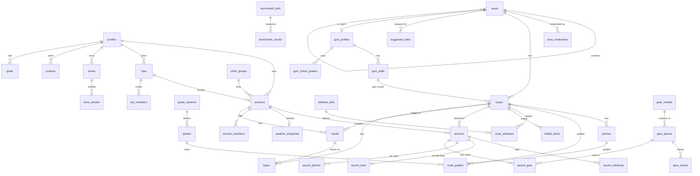

# Sva data schema

This is the data model for the app's local SQLite database (drift) and the Supabase Postgres database. Both use the same tables and column names, so PowerSync can sync them and a future web app can use the same API.

Supported climbing: sport, trad, bouldering, multipitch, alpine, ice, mixed, aid and deep water solo, outdoors and in the gym.

## Conventions

| Rule | Detail |
|---|---|
| IDs | `id` is a UUIDv7, generated on the device. Works offline and sorts by creation time. Seeded shared rows (attribute definitions, grade systems) instead get a UUIDv5 from their stable key and a fixed namespace (`seedId` in `sva_data`), so every device and the server agree on them; the server never accepts client writes to those tables. Every table has a text `id` primary key, join tables included (PowerSync needs it) |
| Ownership | `owner_id` on every user-owned row, child rows included (an ascent's pitches, attributes and gear carry the same owner), so sync rules and row-level security never need a join. Only the owner may change it. Shared rows have `created_by` instead |
| Timestamps | `created_at`, `updated_at` in UTC. `deleted_at` for soft deletes; rows are never hard-deleted by clients |
| Local dates | Sessions store `local_date` (`YYYY-MM-DD`) and `tz` (IANA name, for example `Europe/Oslo`) so a session abroad lands on the right day |
| Units | Always SI: metres (`_m`), kilograms (`_kg`), °C (`_c`), seconds (`_s`), millimetres only where the domain uses them (`edge_mm`, `diameter_mm`). Converted only for display |
| Enumerations | Stored as text keys with a check constraint, not Postgres enum types, so values can be added with a simple migration. Keys are stable identifiers such as `hold.crimp`; display text comes from translations |
| Visibility | `visibility` is `public`, `friends` or `private` wherever a row can be seen by others. A session's child rows (ascents and their pitches, attributes and gear, session members, weather) carry a copy of the session's visibility, so sync rules and row-level security decide on the row alone. Repositories update the copies when the session's visibility changes |
| Shared rows | Public areas and routes, grade systems, attribute definitions and the gear catalog are shared. Nobody owns them; `created_by` is credit, not ownership. Clients never update shared rows directly; they go through moderated requests (`suggested_edits`) or server functions |
| Year-month dates | Gear and shoe dates where only the month is known use `YYYY-MM` text |
| Types across databases | UUID: `uuid` in Postgres, text in SQLite. JSON: `jsonb` / text. Booleans: `boolean` / integer. Location: `latitude`, `longitude` columns in both, plus a PostGIS `geography` column on the server for nearby searches |
| Migrations | Never edit a merged migration. Add a new one |
| PowerSync-ready | On the device, PowerSync owns the synced tables from M11-4 and stores them without foreign keys, check constraints or unique indexes, using only text, integer and real columns. The local schema follows those limits from the start: booleans are integers, JSON and dates are text, timestamps are ISO 8601 text in UTC, and column defaults are set in Dart rather than SQL, because PowerSync's views ignore SQL defaults. Rules such as allowed enumeration keys, references and uniqueness are enforced in `sva_core`, the repositories and Postgres, which keeps full foreign keys, checks and unique constraints |

## Overview

## 1. Users and settings

**profiles**: one per user, `id` equals the Supabase Auth user ID.

| Column | Type | Notes |
|---|---|---|
| id | uuid | Before sign-in, a local ID that is replaced on first sign-in |
| display_name | text | |
| avatar_media_id | uuid → media | Cropped square picture |
| home_area_id | uuid → areas | |
| default_visibility | text | Default for new sessions |
| rack_visibility | text | Who can see your rack |
| grade_prefs | jsonb | Display system per grade type, for example `{"free_route": "nor", "boulder": "font", "ice": "wi"}` |
| theme | text | `system`, `midnight` or `daylight` |
| language | text | `nb` or `en`; null follows the phone's language |
| quiet_hours | jsonb | Start and end for notifications |
| created_at, updated_at, deleted_at | timestamptz | |

**device_tokens** (server only): `id`, `owner_id`, `platform` (`ios`, `android`), `token`, `last_seen_at`.

## 2. Places

**areas**: one tree for every place, from country down to a single boulder block or gym.

| Column | Type | Notes |
|---|---|---|
| id | uuid | |
| parent_id | uuid → areas | Null for top-level countries |
| type | text | `country`, `region`, `area`, `crag`, `sector`, `wall`, `boulder_block`, `gym` |
| name | text | |
| search_key, ascii_key | text | Derived from `name` for search, never typed in: see Name search below |
| country_code | text | ISO 3166-1 alpha-2, set on every row for fast filtering |
| latitude, longitude | double | |
| altitude_m | integer | Important for alpine and ice |
| rock_type | text | `rock.granite`, `rock.limestone` and so on. Children inherit when null |
| aspect | text | `N`, `NE` … for sun and shade |
| approach_min | integer | Walk-in time |
| location_hidden | boolean | Hide exact location from others |
| access_notes | text | Closures, bird nesting, parking |
| visibility | text | `public` for the shared database, `private` for secret spots and for new areas waiting for a moderator |
| merged_into_id | uuid → areas | Set when this duplicate was merged |
| created_by | uuid → profiles | Credit only. While the area is private, only this user can see and edit it |
| created_at, updated_at, deleted_at | | |

The outdoor tree is a set of nested folders: crag → sector → routes. A sector may be split further into walls or boulder blocks. A trigger checks the nesting: a sector's parent is a crag, and an outdoor route's area is a sector, wall or boulder block.

**area_moderators**: who approves requests for a crag or gym. `area_id` → areas, `user_id` → profiles, `granted_by` → profiles, `created_at`. Primary key on (`area_id`, `user_id`).

A request about a row is handled by the moderators of the nearest crag or gym above it (or the row itself, when it is the crag or gym). If that place has no moderators, the request goes up the tree to the region, the country and finally the app admins, so no request is left without someone to decide it. App admins appoint moderators to begin with.

**gym_profiles**: extra settings for areas of type `gym`, one per gym. The gym and its profile are shared and moderated like a crag.

| Column | Type | Notes |
|---|---|---|
| id | uuid | |
| area_id | uuid → areas | One row per gym (unique on the server) |
| grading | text | `colour`, `standard`, `none` |
| route_expiry_weeks | integer | Not used: gym routes have no timer (PLAN.md decision 4). Kept until a later schema change drops it |

**gym_walls**: personal for now, like gym routes. `id`, `owner_id`, `gym_id` → areas, `name`, `height_m`, `angle` (`angle.slab`, `angle.vertical`, `angle.overhang`, `angle.roof`), `angle_deg` (optional integer, degrees past vertical, negative for slabs, from -45 to 90; when set, `angle` follows from it: slab below 0°, vertical 0–5°, overhang 6–60°, roof above 60°), `kind` (`rope`, `boulder`), `last_reset_on` (date; marking a reset retires the open gym routes on the wall), `sort`. Marking a gym route as gone and resetting a wall are personal while gym routes are private. If gym routes become shared, both need a per-user marker or a moderator step instead of setting a shared route's `status`, and a server version of the reset.

**gym_colour_grades**: one row per colour, easiest first. Personal for now, like gym walls.

| Column | Type | Notes |
|---|---|---|
| id | uuid | |
| owner_id | uuid → profiles | |
| gym_id | uuid → areas | |
| sort | integer | |
| name | text | `Blue` |
| colour_hex | text | |
| boulder_min_score, boulder_max_score | numeric | Range on the shared difficulty scale, null when not mapped |
| route_min_score, route_max_score | numeric | Same for rope climbs |

**aliases**: other names for an area or route, used for search and duplicate checks. `id`, `target_type` (`area`, `route`), `target_id`, `name`, `lang`.

**external_ids**: links to other databases for future imports. `id`, `target_type`, `target_id`, `source` (`openbeta`, `thecrag`, `8a`, `mountainproject`, `verticallife`), `external_id`. Unique on (`source`, `external_id`).

## 3. Routes and grades

**routes**: every climbable line, outdoors or in a gym.

| Column | Type | Notes |
|---|---|---|
| id | uuid | |
| area_id | uuid → areas | Sector, wall or boulder block outdoors; the gym indoors |
| kind | text | `outdoor` or `gym` |
| name | text | Null allowed for gym routes, which are shown as colour, grade, wall and date set, for example "Blue 6a · Cave wall · set 12 Oct" |
| search_key, ascii_key | text | Derived from `name`, as on areas |
| discipline | text | `sport`, `trad`, `boulder`, `alpine`, `ice`, `mixed`, `aid`, `dws` |
| pitch_count | integer | Multipitch when greater than 1 |
| length_m | numeric | For gym routes, copied from the wall height |
| angle | text | Main angle |
| protection | text | `protection.bolted`, `.trad`, `.mixed`, `.runout`, `.none`, `.pads`, `.ice_screws` |
| descent | text | `descent.lower_off`, `.rappel`, `.walk_off`, `.downclimb`, `.swim` (deep water solo) |
| rope_length_m | integer | Rope needed |
| rope_type | text | `single`, `half`, `twin`, `none` |
| water_depth_m | numeric | Deep water solo only |
| tide_dependent | boolean | Deep water solo only |
| season_notes | text | Ice formation, conditions windows |
| first_ascent | text | Names |
| first_ascent_year | integer | |
| status | text | `open`, `closed`, `seasonal`, `retired` (for example, a broken hold, or a gym route that is gone or whose wall was reset) |
| visibility | text | `public` (shared) or `private`. Gym routes are always `private` for now |
| consensus_score | numeric | Server-computed from the personal grades on ascents. Public routes only |
| quality_avg | numeric | Server-computed cache |
| gym_wall_id | uuid → gym_walls | Gym routes only |
| gym_colour_grade_id | uuid → gym_colour_grades | Gym routes with colour grading |
| set_on | date | Gym routes only |
| expires_on | date | Not used: gym routes have no timer and end by `status` (PLAN.md decision 4). Kept until a later schema change drops it |
| setter_note | text | Gym routes, for example "the blue in the cave corner" |
| merged_into_id | uuid → routes | Set when merged into another route |
| created_by | uuid → profiles | Credit only. While the route is private, only this user can see and edit it |
| created_at, updated_at, deleted_at | | |

**How a route becomes shared.** A new outdoor route starts as the creator's private route, with an `add_route` request to the moderators of its crag. The creator can log ascents, add photos and tick it straight away, also offline. The moderator then:

- accepts: the route becomes `public` under the sector the creator chose
- rejects: the route stays the creator's private route, and their ascents are kept
- marks it as the same as an existing route: the two are merged, the creator's ascents and photos move to the existing route, and the name they used becomes an alias

New sectors and crags follow the same steps with `add_area` requests. Once a row is public, every change goes through an `edit` request.

**Name search.** Places and routes carry two keys made from the name (sva_core `searchKey` and `asciiKey`, with shared cases in `shared/test_cases/name_keys.json`):

- `search_key`: lower case with æ, ø and å kept as letters. "Aa" counts as "å", "ä" and "ö" as "æ" and "ø", other accents are dropped (é → e), and punctuation becomes a space.
- `ascii_key`: the same with æ → ae, ø → o, å → a, so "floyen" typed on a foreign keyboard finds "Fløyen".

A search term gets the same treatment. It matches `search_key`, and also `ascii_key` when the term itself has no æ, ø or å: someone who types "smått" means å and does not want "Smatt". Lists sort in Norwegian order, with æ, ø and å after z. The device sets the keys on every write; the server computes them in a generated column with the same rules (M11-2), so synced rows arrive with them.

**Duplicate checks.** When someone adds a route, the app searches for similar routes before saving: names and aliases with `pg_trgm` similarity and `unaccent` (so "Fløyen" matches "Floyen"), in the same crag or within about 200 m. Offline, it searches the rows on the device. The moderator sees the same candidates with the request. There is no unique constraint on names, since real duplicates exist (many crags have a route called "Project").

**Gym routes** are private to the user who logs them: no requests, no duplicate checks across users and no consensus grade. They are identified by gym, wall, colour, grade and date set. A friend who sees a shared session sees a gym route only as its label, not the route row. Public gym routes can be added later through `visibility` without moving data.

**pitches**: `id`, `route_id`, `number`, `length_m`, `angle`, `protection`, `description`, `anchor` (`anchor.bolts`, `.gear`, `.tree`, `.ice_threads`), `belay_notes`. Single-pitch routes have one pitch row.

**grade_systems**: shared definitions, stored as data so new systems need no code.

| key | grade_type | Examples |
|---|---|---|
| `nor`, `french`, `yds`, `uiaa`, `aus`, `saxon` | `free_route` | 7-, 6c, 5.11a, VII, 23 |
| `british_adj`, `british_tech` | `free_route` | E3 and 5c, stored as two grade rows on the same route |
| `font`, `v` | `boulder` | 7A, V6 |
| `wi`, `ai` | `ice` | WI4, AI3 |
| `m` | `mixed` | M6 |
| `aid_a`, `aid_c` | `aid` | A2, C1 |
| `alpine_ifas` | `alpine` | F, PD, AD, D, TD, ED |
| `ncs_commitment` | `commitment` | I to VII |
| `danger` | `danger` | G, PG, PG-13, R, X |
| `dws_s` | `dws` | S0 to S3 (danger of the fall into water) |

Columns: `id`, `key` (unique on the server), `name`, `grade_type`, `sort`, `region`.

**grades**: `id`, `system_key`, `label`, `sort`, `score` (numeric on the shared difficulty scale for that grade type; null for types that are not compared, such as danger), `score_low`, `score_high` (for grades that span a range).

**route_grades**: any number of grades per route or pitch.

| Column | Type | Notes |
|---|---|---|
| id | uuid | |
| route_id | uuid → routes | |
| pitch_id | uuid → pitches | Null for the whole route |
| grade_type | text | Same values as on grade_systems |
| grade_id | uuid → grades | |
| source | text | `official`, `guidebook`, `consensus` |

A trad route might have `free_route` E3 + 5c, `danger` R and `commitment` III. An alpine route might have `alpine` D, `free_route` 5+ and `ice` WI3.

**attribute_defs**: shared definitions for the long tail of details. `id`, `key` (unique on the server), `level` (`area`, `route`, `pitch`, `ascent`, `session`), `value_type` (`single`, `multi`, `number`, `bool`), `value_keys` (json array of allowed value keys; `values` is a reserved word in SQL), `sort`. Seeded with features (`feature.face`, `feature.finger_crack`, `.hand_crack`, `.offwidth`, `.chimney`, `.corner`, `.arete`, `.tufa`, `.ice_pillar`, `.ice_curtain`, `.mixed_dry_tool`), holds, ascent tags (`tag.pumpy` …), conditions.

**route_attributes**: `id`, `route_id`, `attribute_key`, `value` (key, number or bool as text). One row per value, so multi-value attributes have several rows; unique on the three columns on the server.

Common filters (discipline, angle, protection, rock type) are typed columns. Attribute tables hold the rest.

**suggested_edits**: requests to change shared data. Anyone can make one; a moderator of the crag or gym decides.

| Column | Type | Notes |
|---|---|---|
| id | uuid | |
| kind | text | `edit`, `add_route`, `add_area`, `share_topo` |
| target_type | text | `area`, `route`, `pitch`, `media` |
| target_id | uuid | The row to change, or the new private row to accept |
| moderating_area_id | uuid → areas | The crag or gym whose moderators decide, set by the server when the request is saved |
| changes | jsonb | Field → new value, for `edit` |
| old_values | jsonb | Field → value when the request was made. A request is stale if the row has changed since |
| reason | text | |
| status | text | `open`, `applied`, `rejected`, `merged` (accepted as the same as an existing row) |
| merged_into_id | uuid | The existing row, when `status` is `merged` |
| created_by | uuid → profiles | |
| resolved_by | uuid → profiles | The moderator |
| moderator_note | text | Shown to the person who made the request |
| created_at, resolved_at | timestamptz | |

**edit_votes**: `edit_id`, `user_id`, `vote` (`up`, `down`). Shown to moderators as a hint; votes do not apply a request.

**route_history**: `id`, `route_id`, `field`, `old_value`, `new_value`, `changed_at`, `suggested_edit_id`. Records grade changes, retro-bolting and similar.

**topos**: `id`, `route_id` (or `area_id` for a wall overview), `media_id` (the photo), `data` (jsonb: lines, symbols, pitch labels, in coordinates relative to the photo), `version`, `status` (`draft`, `published`), `created_by`.

## 4. Trips, sessions and ascents

**trips**: `id`, `owner_id`, `name`, `start_date`, `end_date`, `area_id` (main place), `description`, `visibility`.

**trip_members**: `id`, `owner_id`, `trip_id`, `user_id` (or null), `guest_name`, `status` (`pending`, `accepted`, `declined`, `guest`).

**climb_groups**: links the copies of a shared session. `id`, `owner_id` (who shared it), `created_at`.

**sessions**

| Column | Type | Notes |
|---|---|---|
| id | uuid | |
| owner_id | uuid → profiles | |
| trip_id | uuid → trips | Optional |
| climb_group_id | uuid → climb_groups | Set when the session is shared with partners |
| area_id | uuid → areas | Crag, sector or gym |
| setting | text | `outdoor`, `indoor` |
| local_date | text | `YYYY-MM-DD` |
| tz | text | IANA time zone |
| start_at, end_at | timestamptz | Optional |
| title | text | |
| description | text | |
| visibility | text | |
| location_hidden | boolean | |
| default_shoe_id | uuid → shoes | |
| elevation_gain_m | integer | |
| conditions | text | `condition.dry`, `.perfect`, `.humid`, `.wet`, `.icy`, … |
| created_at, updated_at, deleted_at | | |

**weather_snapshots**: `id`, `owner_id`, `session_id` (one per session), `source` (`open_meteo`), `temp_c`, `precip_mm`, `wind_ms`, `humidity_pct`, `cloud_pct`, `water_temp_c` (deep water solo), `raw` (jsonb, the provider's answer without its coordinates), `fetched_at`.

**session_members**: `id`, `owner_id` (the session's owner), `session_id`, `user_id` (null for people without the app), `guest_name`, `status` (`pending`, `accepted`, `declined`, `guest`), `invited_by`.

**ascents**

| Column | Type | Notes |
|---|---|---|
| id | uuid | |
| owner_id | uuid → profiles | |
| session_id | uuid → sessions | |
| route_id | uuid → routes | |
| ordinal | integer | Order within the session |
| ascent_type | text | `lead`, `follow`, `toprope`, `solo`, `free_solo`, `dws`, `aid`, `simul`, `boulder`. Indoors only `lead`, `toprope` and `boulder`: an auto-belay climb logs as `toprope` |
| style | text | `onsight`, `flash`, `redpoint`, `repeat`, `attempt` |
| tries | integer | Follows the rules in PLAN.md decision 7. A redpoint counts the attempts before it, so when an edit adds or removes one of those attempts, the redpoint's tries move by the same number (never below 2) |
| falls | integer | |
| rests | integer | Hangs or takes |
| high_point | text | For attempts and projects, for example "third bolt" |
| feel | text | `feel.very_soft` … `feel.very_hard` |
| personal_grade_id | uuid → grades | Optional exact personal grade |
| official_grade_id | uuid → grades | Snapshot of the main official grade at the time |
| difficulty_score | numeric | Cache for stats, from the snapshot |
| quality_stars | integer | 0 to 3 |
| duration_s | integer | Optional time on route |
| shoe_id | uuid → shoes | Overrides the session's shoes |
| setting | text | Cache: `outdoor`, `indoor` |
| discipline | text | Cache from the route |
| created_at, updated_at, deleted_at | | |

**ascent_beta**: beta notes on an ascent. `id`, `owner_id`, `ascent_id`, `beta_notes`. Always private: they live in their own owner-only table, so no sync rule or view for friends can reach them, even one that sends whole ascent rows.

**ascent_pitches**: one row per pitch climbed, also for single-pitch routes.

| Column | Type | Notes |
|---|---|---|
| id | uuid | |
| ascent_id | uuid → ascents | |
| pitch_id | uuid → pitches | |
| number | integer | |
| leader | text | `self`, `partner`, `simul`, `none` (top-rope, solo) |
| leader_member_id | uuid → session_members | Who led when it was a partner |
| style | text | Same values as ascents |
| falls, rests | integer | |
| notes | text | |

**ascent_attributes**: `id`, `owner_id`, `ascent_id`, `attribute_key`, `value`. Holds tags and other ascent details.

**ascent_gear**: `id`, `owner_id`, `ascent_id`, `gear_piece_id`, `count`, `borrowed_from` (uuid → profiles or null). The rack taken on that climb.

## 5. Media

**media**

| Column | Type | Notes |
|---|---|---|
| id | uuid | |
| owner_id | uuid → profiles | Null once the photo is shared as a topo |
| session_id | uuid → sessions | Null for profile pictures and topo photos |
| route_id | uuid → routes | Optional route tag |
| ascent_id | uuid → ascents | Optional, when it belongs to one ascent |
| kind | text | `photo`, `video` |
| storage_path, thumb_path | text | Supabase Storage paths; local paths until uploaded |
| width, height | integer | |
| duration_s | numeric | Videos |
| caption | text | |
| taken_at | timestamptz | |
| sort | integer | |
| upload_state | text | `local`, `uploading`, `uploaded`, `failed` |
| exif_stripped | boolean | Must be true before upload |
| visibility | text | Inherits the session's by default |
| share_state | text | `none`, `pending`, `shared`, `rejected`. For sharing a photo as a topo |
| credited_to | uuid → profiles | The person who took a shared topo photo |

**Sharing a topo photo.** A user can offer a photo of a route or wall as a shared topo, after agreeing to a short consent text. That creates a `share_topo` request and sets `share_state` to `pending`. When a moderator accepts, the photo becomes shared content: `owner_id` is cleared, `credited_to` keeps the credit, and the photo stays if the account is deleted. When rejected, the photo stays the user's own and follows its `visibility`.

## 6. Gear and shoes

**gear_models**: shared catalog. `id`, `brand`, `model`, `category`, `size_label`, `colour_hex`, `specs` (jsonb: range in mm, strength in kN, weight in g, length).

Categories: `cam`, `nut`, `hex`, `tricam`, `sling`, `alpine_draw`, `quickdraw`, `carabiner`, `locker`, `belay_device`, `nut_tool`, `rope`, `harness`, `helmet`, `ice_screw`, `ice_tool`, `crampons`, `aider`, `hook`, `cam_hook`, `daisy`.

**gear_pieces**: each physical piece you own.

| Column | Type | Notes |
|---|---|---|
| id | uuid | |
| owner_id | uuid → profiles | |
| model_id | uuid → gear_models | Optional |
| category | text | |
| label | text | "Cam #1" |
| colour_hex | text | |
| serial | text | |
| made_on, bought_on | text | `YYYY-MM` |
| reslung_on | text | `YYYY-MM`, cams and hexes |
| resling_interval_months | integer | |
| retire_after_months | integer | Textiles and ropes |
| remind | boolean | |
| in_default_rack | boolean | |
| specs | jsonb | Rope length and diameter, screw length |
| retired_on | text | `YYYY-MM` |
| notes | text | |

Pieces are grouped by model in the UI, so two #1 cams show as "×2" but keep their own resling dates.

`reslung_on` and `retired_on` on a piece follow its `gear_events`: logging a `reslung` or `retired` event sets them to the latest such month, so reminders come from the history.

**gear_events**: `id`, `owner_id`, `piece_id`, `kind` (`reslung`, `inspected`, `fall_held`, `lent`, `retired`), `date`, `notes`.

**shoes**: `id`, `owner_id`, `brand`, `model`, `size_label`, `colour_hex`, `closure` (`velcro`, `lace`, `slipper`), `default_for` (json array: `gym`, `sport`, `boulder`, `trad`, `ice`), `bought_on`, `resole_after_days`, `retired_on`, `notes`.

**shoe_resoles**: `id`, `owner_id`, `shoe_id`, `date`, `notes`.

## 7. Projects and goals

**ticklist_items**: `id`, `owner_id`, `route_id`, `added_on`, `priority`, `note`, `done_ascent_id`.

**projects**: `id`, `owner_id`, `route_id`, `started_on`, `status` (`active`, `sent`, `paused`, `abandoned`), `high_point`, `beta_notes`, `sent_ascent_id`. History comes from ascents on the route.

**goals**

| Column | Type | Notes |
|---|---|---|
| id | uuid | |
| owner_id | uuid → profiles | |
| kind | text | `grade`, `count`, `first`, `benchmark` |
| target | jsonb | Structured, for example `{"metric": "max_score", "filters": {"discipline": "sport", "style": "onsight"}, "threshold": 70}` |
| deadline | date | Optional |
| status | text | `active`, `achieved`, `abandoned` |
| achieved_on | date | |
| source_gap | text | The CV gap it was created from, for example `feature.offwidth` |
| visibility | text | |

## 8. Training

**benchmark_defs**: `id`, `key`, `name`, `protocol`, `unit` (`pct_bw`, `kg`, `s`, `reps`, `cm`, `deg`), `higher_is_better`, `owner_id` (null for the standard tests).

**benchmark_results**: `id`, `owner_id`, `benchmark_id`, `performed_on`, `value`, `bodyweight_kg`, `added_kg`, `edge_mm`, `grip` (`grip.half_crimp`, `.open`, `.full_crimp`), `duration_s`, `notes`, `visibility`.

## 9. Social (server)

| Table | Columns | Notes |
|---|---|---|
| friendships | `id`, `requester_id`, `addressee_id`, `status` (`pending`, `accepted`, `declined`), `created_at`, `responded_at` | Unique per pair |
| blocks | `blocker_id`, `blocked_id`, `created_at` | Blocks hide content both ways |
| reports | `id`, `reporter_id`, `target_type`, `target_id`, `reason`, `details`, `status` | |
| kudos | `id`, `user_id`, `target_type` (`session`, `media`), `target_id`, `created_at` | Unique per user and target |
| comments | `id`, `author_id`, `target_type`, `target_id`, `body`, `edited_at`, `deleted_at` | |
| endorsements | `id`, `endorser_id`, `endorsee_id`, `skill` (`skill.trad_placement` …) | Friends only |
| notifications | `id`, `recipient_id`, `kind`, `actor_id`, `target_type`, `target_id`, `read_at`, `created_at` | |
| notification_prefs | `user_id`, `kind`, `push`, `in_app` | |

## Server rules

- Row-level security on every table. Owners write their own rows. Reads follow `visibility`, friendships and blocks.
- Hidden locations stay hidden. For an area with `location_hidden`, every view and sync query for other users returns null `latitude` and `longitude`. For a session with `location_hidden`, they get no `area_id`. Weather is saved without the request's coordinates (`raw` keeps only the weather fields). pgTAP tests check that a friend cannot read any of these.
- Postgres functions for multi-row operations: accept a shared session, merge routes or areas, decide a request (accept, reject or merge), respond to a friend request. Only a moderator of the request's `moderating_area_id`, or an app admin, may decide it.
- Merging moves everyone's ascents, media, topos, ticklist items and projects to the remaining row, keeps the old name as an alias and keeps the old row with `merged_into_id` set. A trigger on new ascents and media follows `merged_into_id` to the remaining row, for devices that were offline during the merge.
- When a request is saved, a trigger notifies each moderator of its crag or gym (`mod.request`). When it is decided, the person who made it is notified (`mod.resolved`).
- Triggers check style and tries rules on ascents, using the same test cases as `sva_core`.
- Scheduled jobs: recompute consensus grades and quality.
- Account deletion: personal rows are deleted, including private routes, gym routes and open requests. Ascents on shared routes are kept without an owner and marked private, so consensus grades stay correct. Shared topo photos are kept, without the credit.

## On the device

The drift schema in `packages/sva_data/lib/src/database/` holds every table above except the server-only ones: `device_tokens`, `aliases`, `external_ids`, `area_moderators`, `suggested_edits`, `edit_votes`, `route_history` and the social tables in §9 (social rows reach the device with M13). Saved schema versions live in `packages/sva_data/drift_schemas/`, and a test migrates every saved version to the latest. To change a table, bump `schemaVersion`, add a migration step, run the two `drift_dev schema` commands from CLAUDE.md, and commit the generated files.

## Sync scope

- Synced to the device: all your own rows; areas, routes, pitches and grades you have climbed, ticked or added; grade systems and attribute definitions; friends' public and friends-only sessions from the last few months.
- Fetched on demand, not synced: searching the shared route database, other users' profiles.

## Indexes for stats

- `ascents (owner_id, setting, discipline)`, `sessions (owner_id, local_date)`, `ascents (owner_id, route_id)` for the tries rules, and `ascents (session_id)` to open a session.
- `ascent_attributes (attribute_key, value)`, `route_attributes (attribute_key, value)`.
- `routes (area_id)`, `areas (parent_id)`, `areas (country_code)`, PostGIS index on area location.
- `media (session_id)`, `session_members (user_id, status)`.

## Open questions

- Small crags often have no sectors. Either a route may sit directly under a crag, or the app creates a hidden default sector.
- Whether a shared topo photo can be withdrawn after a moderator has accepted it. The consent text must say which.
- Whether moderators of a crag can appoint other moderators, or only app admins can.
- Via ferrata and ski touring are not included. They can be added as disciplines later without schema changes beyond new keys.
